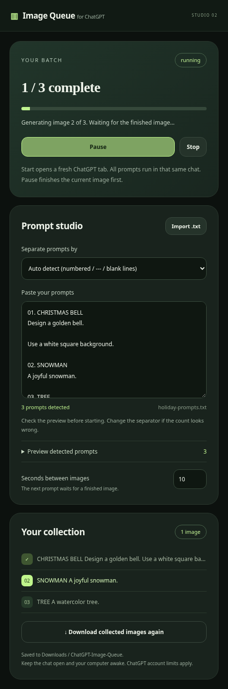

# Image Queue for ChatGPT · Studio 02 (v0.2.1)

A Chrome side panel for importing a batch of image prompts and generating them in sequence. No build step, account API key, or package dependencies.



Try [examples/image-prompts.txt](examples/image-prompts.txt) to check a three-prompt import.

## Install or update

1. Download **Code → Download ZIP** from this repository and extract it.
2. Open `chrome://extensions` and enable **Developer mode**.
3. For a new install, select **Load unpacked** and choose the folder containing `manifest.json`. For an update, replace the files in your existing extension folder and click **Reload** on its Chrome extension card. Chrome may ask you to accept the new side-panel permission.
4. Use Chrome 116 or newer. Sign in to `https://chatgpt.com` using your regular browser profile.
5. Click the extension icon to open its side panel. Import a `.txt` file or paste prompts.
6. Check **prompts detected** and **Preview detected prompts**. Choose a separator mode if needed.
7. Click **Start in a new chat**. The extension opens a fresh ChatGPT tab, waits for the input to load, then submits prompts in order in that same conversation. Keep the tab open; avoid sending manual messages in it.

The extension selects **Create image** when the English control is available directly or in **Tools**, and also requests the image tool explicitly in each prompt. It waits for a new, loaded image, no visible streaming/generation indicator, and 12 seconds of stable image sources before recording completion and advancing.

## Text file formats

**Auto detect** prefers explicit separators, then multiple numbered headings, then blank lines. Windows line endings and a UTF-8 BOM are supported. For multiline prompts with internal blank paragraphs, use numbered headings or explicit separators:

```text
01. CHRISTMAS BELL
Design a vintage golden Christmas bell ornament.

Keep the background white and square.

02. SNOWMAN
A cheerful watercolor snowman.
```

```text
A moon garden.
Add soft blue lighting.
---
A miniature coastal village.
```

For a file with one prompt per line, select **One prompt per line**. Auto detection cannot reliably infer whether lines or paragraphs are separate prompts; the preview shows exactly what will be submitted. A batch can contain 1–100 prompts. The file import limit is 5 MB.

## Restored ChatGPT drafts

ChatGPT can restore an unsent draft even in a newly opened tab. On the first prompt, the extension saves a local backup of that draft before clearing it and entering the batch prompt. The panel then offers **Download saved chat draft (.txt)**. Download that backup before starting another batch, since the new batch replaces the previous batch state. If backing up fails, the draft is left unchanged and the queue pauses. Placeholder decorations and noneditable image-tool chips are ignored when checking for a draft.

A draft entered between later prompts is left untouched; save or clear it manually before resuming. An unsent draft that exactly matches the current extension prompt can be reused on retry.

## Controls and downloads

- **Pause** finishes monitoring the current image and prevents the next prompt.
- **Resume** continues the queue. On a generation error, it retries the current prompt: check the conversation first to avoid duplicates.
- **Stop** cancels extension monitoring. An already submitted ChatGPT request may continue on the website.
- Closing the panel does not stop the queue. Reloading the chat while monitoring an image pauses it with an explanation. Closing the chat stops the queue.

Images download as they finish to `Downloads/ChatGPT-Image-Queue/<batch-id>/`. Chrome controls the download directory; allow multiple downloads if asked. **Download collected images again** retries saved downloads. The extension retains image bytes when accessible. If the image CDN blocks page fetching, it passes the HTTPS asset URL to Chrome’s download manager; those signed URLs may expire, so later re-downloads may fail. Download acceptance is not proof the file finished saving: Chrome’s download history shows its final status.

## Limits and privacy

ChatGPT's website UI changes over time. Actual generation requires a signed-in account with image-generation access. Rate limits, refusals, account restrictions, and service terms still apply. Missing images or editor errors pause the queue; no limit bypass is attempted. No external server is used. Drafts, batch state, and collected images or asset URLs are stored locally in Chrome extension storage. A new batch replaces the previous batch history but leaves downloaded files intact. Remove the extension to clear its local data. Large image batches consume memory and disk.

## Development and verification

```sh
node --test tests/*.test.cjs
```

Node.js 18+ is required for tests. Optional browser fixture checks require Python Playwright and `/usr/bin/chromium`:

```sh
python3 tests/browser_check.py
```

These checks exercise TXT upload/parsing, queue sequencing, a delayed editor without `#prompt-textarea`, actual editor insertion and send events, completion monitoring, and avoiding previous-image duplication. They use a mocked ChatGPT page and do not establish live compatibility with every ChatGPT layout or signed-in account.
